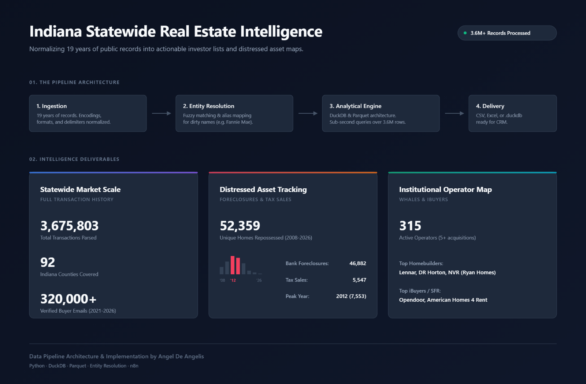
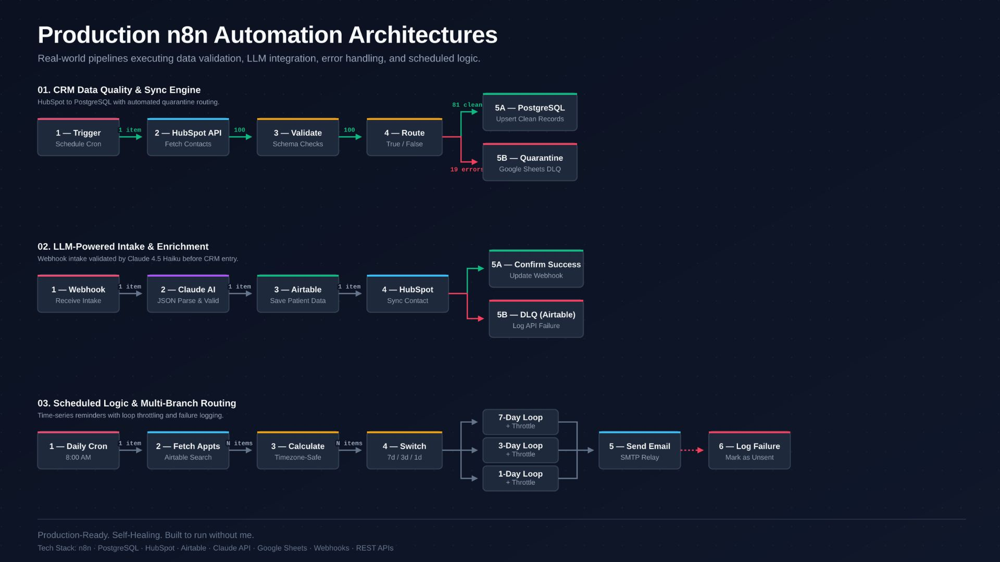
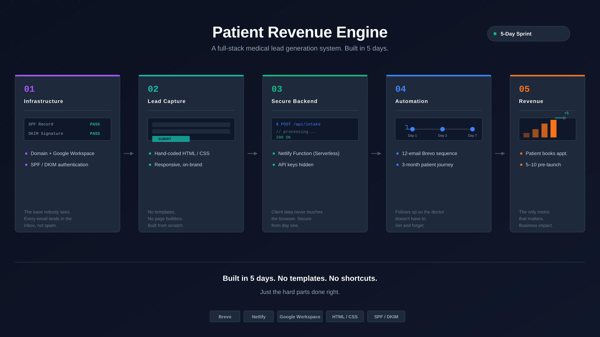
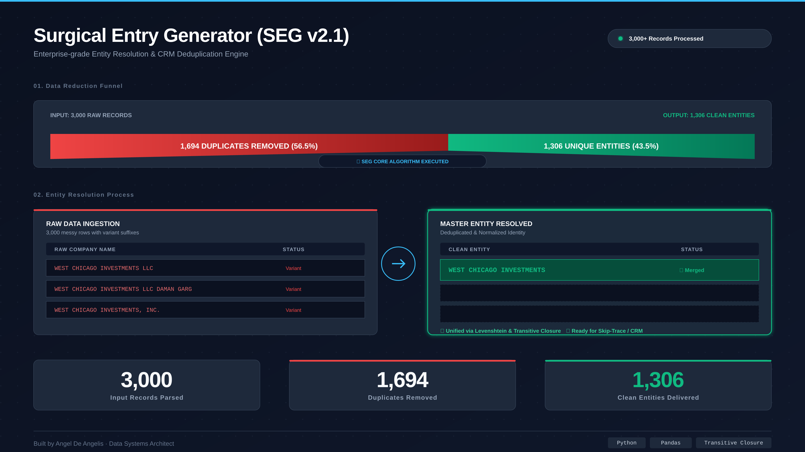
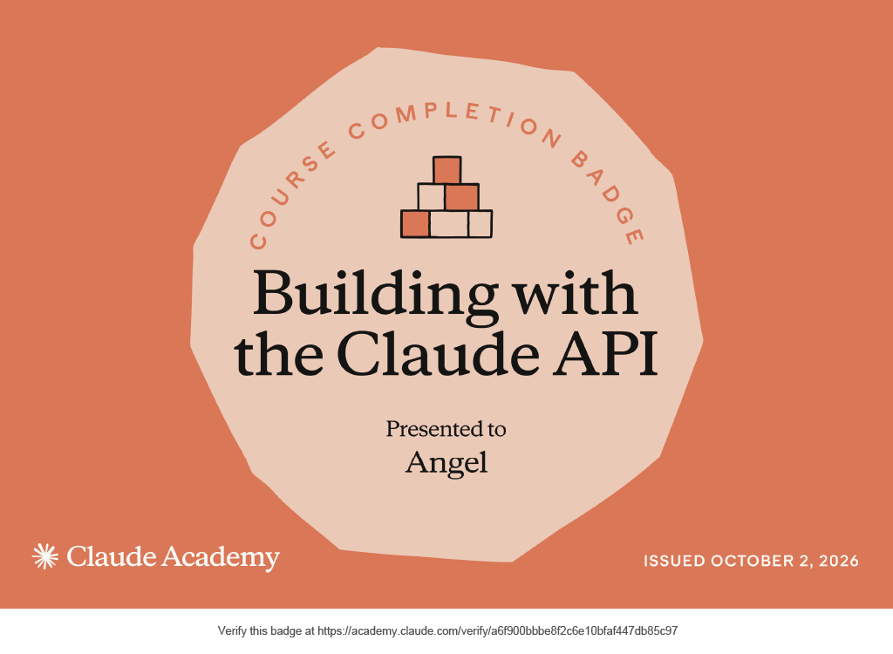
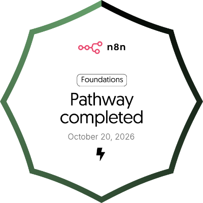
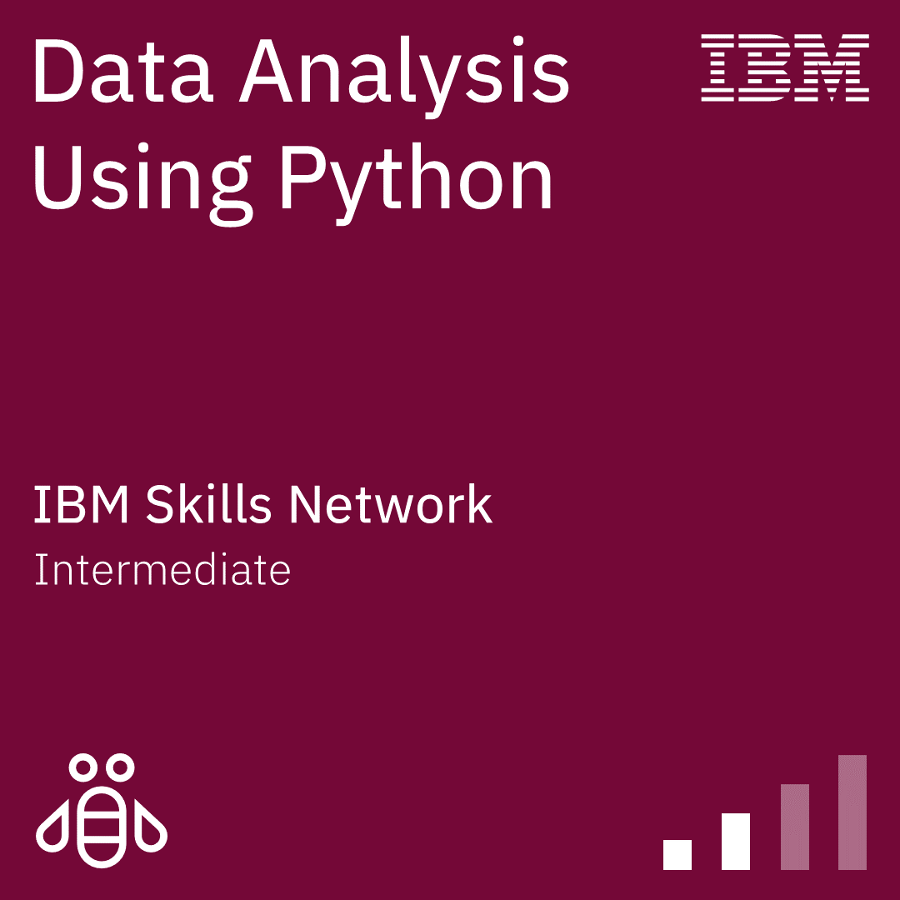
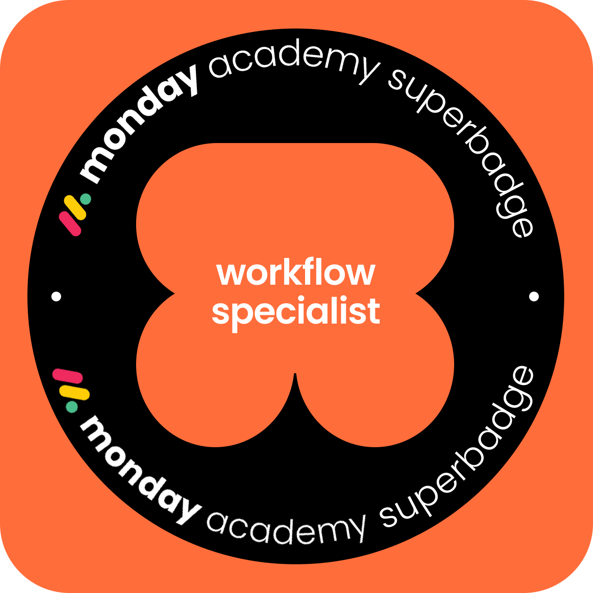

# Ángel De Angelis

**Data Engineer | Real Estate Intelligence & Automation Pipelines**
*Python · SQL · DuckDB · n8n · Playwright · HubSpot*

---

I build automated systems that turn chaotic data into revenue-ready infrastructure.

Most CRMs fail on import. 40% of records error out. Duplicates resurface three days later. Phone numbers break validation rules. The problem is never the data — it's the absence of a gate between the spreadsheet and the system.

I build that gate.

*With a background in Civil Engineering, I approach data architecture like physical infrastructure: if the foundation leaks, the whole building falls.*

---

## ⚡ What I Do

**Real Estate Data Intelligence**
Building pipelines that ingest decades of public county records, normalize entity names (LLCs, Trusts, Banks), and output queryable databases (DuckDB/PostgreSQL) for investors and wholesalers.

**Data Hygiene & CRM Integration**
Pipeline architecture that transforms raw exports into decision-ready records with full audit trails. Confidence-scored merges, canonical formatting, and direct import mapping for HubSpot and Salesforce.

**Workflow Automation**
Self-hosted n8n orchestration connecting APIs, webhooks, and CRMs. Zero third-party subscriptions. Scheduled syncs, error handling, and quarantine logic for invalid records.

**Web Scraping & ETL**
Async Playwright pipelines for high-concurrency extraction. Structured output with validation layers. SQL/PostgreSQL persistence with schema enforcement.

---

## 🛠️ Featured Work

### 🏠 Indiana Statewide Real Estate Intelligence (SDF)
Built a data pipeline that ingested 19 years of Indiana public records (**3.67M transactions**) and normalized it into a queryable DuckDB asset. Mapped **52,359 distressed properties** and isolated **315 institutional buyers**.

`Python` `DuckDB` `Parquet` `Entity Resolution` `Data Cleaning`

 

### ⚙️ Production n8n Pipelines: CRM Sync, LLM Intake & Routing
Engineered three fault-tolerant automation workflows. Includes CRM data validation with a PostgreSQL quarantine layer (DLQ), Claude AI intake parsing, and timezone-safe scheduled logic to prevent SMTP rate limits.

`n8n` `PostgreSQL` `Claude API` `Airtable` `HubSpot`

 

### 🏥 Patient Revenue Engine — Medical Practice
Built in 5 days. 12-email automated patient journey, secure lead capture (Netlify Functions), and full DNS/SPF/DKIM infrastructure. **Generated 5–10 appointments before official launch.**

`n8n` `Brevo` `Netlify` `Google Workspace` `SPF/DKIM/DMARC`

 

#### 🧬 SEG v2.1 — Surgical Entry Generator
Production-grade Python pipeline for contact database hygiene. Auto-schema detection, transitive deduplication, blocking index, and composite key matching with confidence scoring (0–100). Tested on 3,000 raw records: eliminated 56% of duplicates to deliver pristine, CRM-ready entities.

`Python` `Pandas` `SQL` `HubSpot API` `Salesforce API`

---

📜 <b>View Verified Certifications (Click to expand)</b>

 

  
  &nbsp;&nbsp;&nbsp;&nbsp;
  
  &nbsp;&nbsp;&nbsp;&nbsp;
  
  &nbsp;&nbsp;&nbsp;&nbsp;
  

 

**Data Engineering & AI**
* **Building with the Claude API** — Anthropic (Verified)
* **IBM Data Analysis Using Python** — IBM Skills Network (Intermediate)
* **IBM Python for Data Science** — IBM Skills Network
* **IBM SQL and Relational Databases 101** — IBM Skills Network

**Automation & CRM Architecture**
* **n8n Foundations Pathway** — n8n (Completed Oct 2026)
* **Monday.com Workflow Specialist** — Monday Academy
* **HubSpot Data Integrations Certified**
* **Salesforce Integration Certified**

*10+ credentials across data engineering, AI integrations, database architecture, CRM systems, and workflow automation.*

---

### 📬 Let's Connect

- **Email:** [angeldeangelis1@gmail.com](mailto:angeldeangelis1@gmail.com)
- **LinkedIn:** [linkedin.com/in/angeldeangelis](https://www.linkedin.com/in/angeldeangelis/)
- **Freelance / Contract:** [Upwork Profile](https://www.upwork.com/freelancers/~015591486ae29424db)

*Is your next campaign built on clean data or inherited chaos?*
